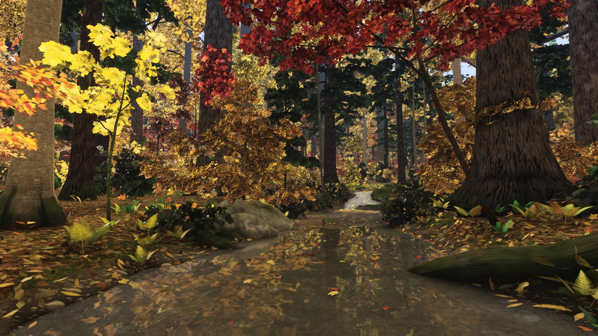
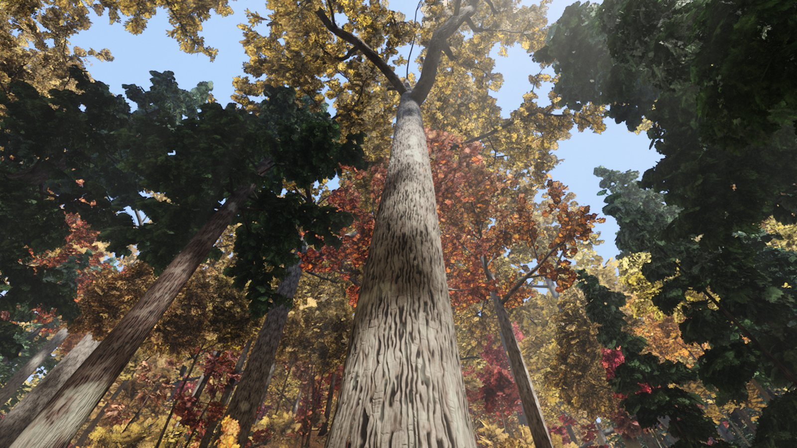
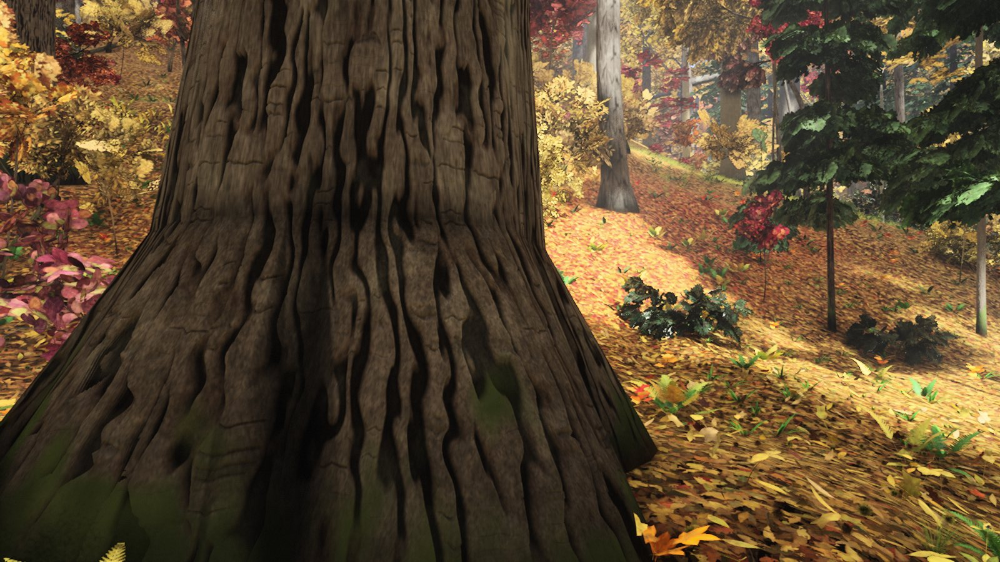
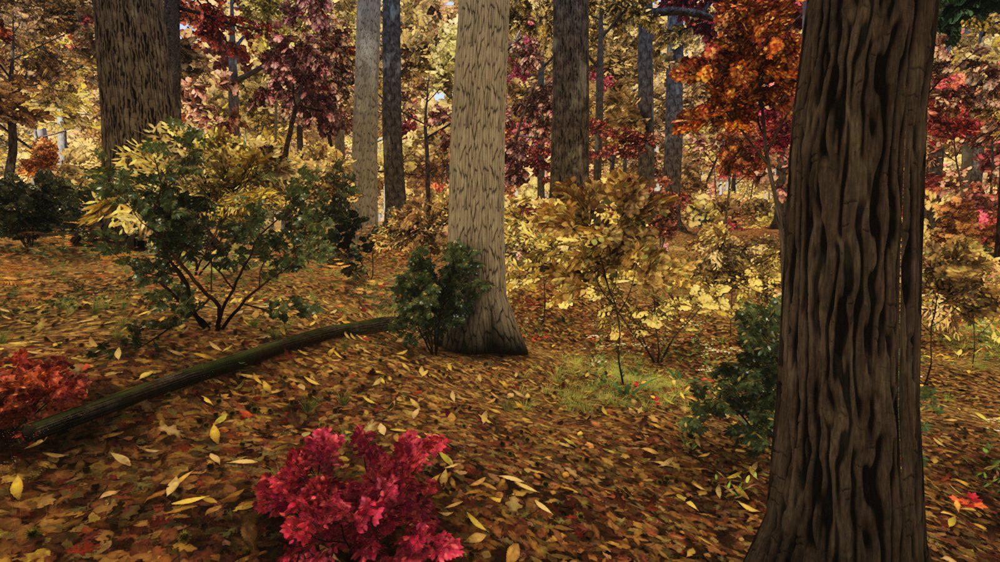

# Chestnut Cove

A real-time, fully procedural three.js world: an old-growth American chestnut forest in a southern Appalachian cove, mid-October, about 1850, before the chestnut blight. The terrain, stream, rocks and dead wood, around 30 woody species, about 45 ground-layer plants, every leaf, bark and leaf-litter texture, the sky and the weather are all generated in the browser when the page loads. There are no photo textures or scanned models.



| | |
|---|---|
|  |  |
|  | |

## Running it

There is no build step. Serve the folder over HTTP and open it in a browser with WebGL2:

```bash
npx http-server . -c-1
```

Then open http://localhost:8080. Building the world takes 5–10 seconds on first load.

**Controls:** click to look around · W A S D walk · Shift run · F fly (E/Q up and down) · 1–9 viewpoints · T let the day pass · N plant names · Tab settings (time of day, weather, quality, field of view) · H hide the UI

**URL options:**

| Option | Effect |
|---|---|
| `q=low\|medium\|high\|ultra` | quality preset (default `high`, `low` on phones) |
| `hour=5.5`…`19.5` | time of day |
| `weather=clear\|fair\|overcast\|mist\|rain\|after\|breezy` | weather |
| `view=october\|grove\|trunk\|bark\|floor\|cascade\|ridge\|gap\|ravine\|canopy\|vista\|stream` | start at a viewpoint |
| `seed=N` | a different world (default `1850`) |
| `res=0.5`…`1` | starting render scale; `dyn=0` turns automatic resolution scaling off |
| `hud=0` | no UI |
| `still=1` | freeze wind, water and film grain (for measuring render noise with `tools/noise.mjs`) |

## How it is put together

- `src/core/` – random numbers and noise, shared GLSL (lighting, shadows, wind), engine setup and quality presets
- `src/render/` – sun, sky and weather; shadow maps; the post-processing pipeline (volumetric fog and light shafts, ambient occlusion, temporal anti-aliasing, bloom, auto-exposure, tone mapping)
- `src/world/` – terrain and stream channel, ecology (which species grow where, by moisture, slope and distance to water), forest floor, water, rocks, dead wood, the distant ridges, falling leaves and rain
- `src/flora/` – the leaf painter and per-species leaf specs, bark baker, twig/spray atlases, the tree generator (skeleton, bark tubes, leaf cards, LODs, real leaves close up), instanced vegetation, ground flora
- `src/ui/` – walking/flying controls, viewpoints, settings panel, plant identification, procedural ambient sound
- `vendor/` – three.js r187 (MIT licence)
- `tools/` – Playwright scripts used during development: screenshots of viewpoints and species portraits, debug pages for leaf, twig and bark textures, and diagnostics. They expect a Chromium with GPU access; the comment at the top of each shows how they were run (through a local job wrapper you can leave out).

## Reviews

`reviews/` holds the brief given to AI critic agents and their reports from two review rounds, one critic each for photorealism, botany and immersion. Round 2 scored photorealism 4.5/10, immersion 5/10 and botany 6.5/10; none of the critics was satisfied. Since round 2, inside-out trunk geometry, the cause of several of their complaints about trunks, has been fixed. The screenshots and reference photographs the reports cite are not in this repository.
